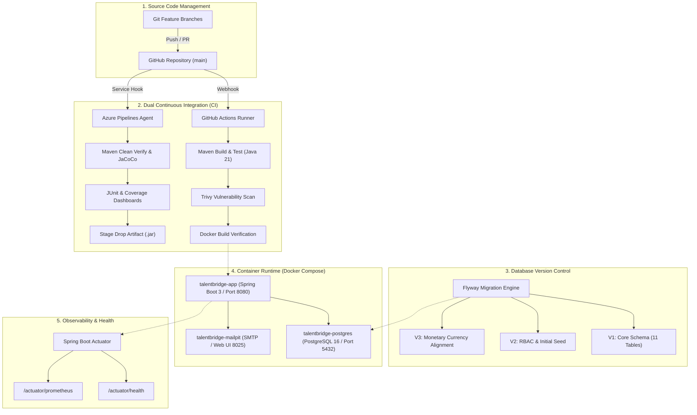

# TalentBridge ATS — Enterprise DevOps Project Proposal & Technical Report

**Course:** DevOps Engineering / Cloud & DevOps Lab  
**Project Title:** TalentBridge Enterprise Applicant Tracking System (ATS)  
**Repository:** [ashokpsgitech/devops-mini-project--Recruitment-portal](https://github.com/ashokpsgitech/devops-mini-project--Recruitment-portal)  
**Author / Candidate:** Ashok V  
**Date:** October 2026  

---

## 1. Executive Summary

TalentBridge ATS is a cloud-native, high-velocity Applicant Tracking System designed for recruiting teams, hiring managers, and job seekers. Built with an enterprise-grade backend (**Spring Boot 3, Java 21, PostgreSQL 16**) and modern frontend UI (**Thymeleaf, Tailwind-inspired CSS**), the project serves as an end-to-end showcase of modern **DevOps & DevSecOps methodologies**.

The project implements automated **Continuous Integration (CI)** across two independent enterprise platforms (**GitHub Actions** and **Azure Pipelines**), automated code quality and test reporting (**JUnit 5, JaCoCo**), container image vulnerability scanning (**Aqua Security Trivy**), database schema version control (**Flyway**), and production-ready containerized orchestration (**Docker & Docker Compose**).

---

## 2. Problem Statement & Objectives

### 2.1 The Problem
Traditional enterprise recruitment applications often suffer from:
- Fragile monolithic deployments with downtime during updates.
- Lack of automated testing, resulting in runtime regression errors during recruitment workflows (e.g., candidate stage transitions, interview scheduling).
- Inconsistent development vs. production environments ("works on my machine" syndrome).
- Security vulnerabilities in base container images and third-party dependencies.

### 2.2 DevOps Project Objectives
1. **Automate Build & Test Verification:** Enforce 100% automated build execution and test passes on every Git commit.
2. **Multi-CI Redundancy:** Demonstrate dual-pipeline orchestration supporting both **GitHub Actions** and **Azure DevOps Pipelines**.
3. **Shift-Left Security (DevSecOps):** Automatically scan container images for `CRITICAL` and `HIGH` CVE vulnerabilities prior to deployment.
4. **Declarative Infrastructure & Orchestration:** Package the entire system (application, relational database, email sandbox) into isolated, self-healing Docker containers.
5. **Observability & Health Probes:** Expose standard enterprise health check endpoints compatible with Kubernetes and Docker health monitoring.

---

## 3. DevOps Architecture & Toolchain



---

## 4. DevOps Tools Breakdown

| Stage | Tool / Technology | Implementation in TalentBridge |
| :--- | :--- | :--- |
| **Source Code Management** | Git & GitHub | Branch protection on `main`, pull request verification, commit tracking |
| **Build Automation** | Apache Maven Wrapper (`./mvnw`) | Dependency resolution, compilation with `-B` batch mode, reproducible builds |
| **Testing & Quality** | JUnit 5, Mockito, JaCoCo | 20 automated unit & integration tests covering security, controllers, and services |
| **Continuous Integration (CI 1)** | GitHub Actions | Multi-job pipeline (`.github/workflows/ci.yml`) triggered on push & pull request |
| **Continuous Integration (CI 2)** | Azure Pipelines | Enterprise YAML pipeline (`azure-pipelines.yml`) running on hosted Ubuntu agents |
| **DevSecOps / Security** | Aqua Security Trivy | Container image vulnerability scanning checking for CVEs; reports uploaded to GitHub SARIF |
| **Database Migrations** | Flyway | Automated SQL schema migrations (`V1`, `V2`, `V3`) executed on startup |
| **Containerization** | Docker | Multi-stage `Dockerfile` (Eclipse Temurin JDK 21 builder & JRE 21 runtime) |
| **Container Security** | Non-root Linux User | Container executes as unprivileged `appuser:appgroup` (UID: 10001) |
| **Local Orchestration** | Docker Compose | Multi-container stack (`app`, `postgres`, `mailpit`) with container health checks |
| **Observability** | Spring Boot Actuator | Production telemetry (`/actuator/health`, `/actuator/info`, `/actuator/prometheus`) |

---

## 5. Key DevOps Features Implemented

### 5.1 Multi-Stage Dockerfile Optimization
The application uses a 2-stage build in `Dockerfile`:
- **Stage 1 (Builder):** `eclipse-temurin:21-jdk-jammy` downloads dependencies and compiles the source code into a packaged Spring Boot JAR.
- **Stage 2 (Runtime):** Extracts JAR layers using `layertools` and copies only dependencies and application bytecode into a lean `eclipse-temurin:21-jre-jammy` base image.
- **Security Hardening:** Creates a dedicated user `appuser` (UID 10001), preventing root exploits within the container.

### 5.2 Multi-Platform CI Redundancy
- **GitHub Actions:** Provides quick feedback on PRs and runs automated vulnerability scanners.
- **Azure Pipelines:** Demonstrates enterprise capability to link a GitHub source repository to an external Azure DevOps Organization, running Maven builds, publishing JUnit reports, and generating JaCoCo code coverage dashboards.

### 5.3 Automated Database Migration with Flyway
Eliminates database synchronization issues across team members and deployment targets:
- `V1__initial_schema.sql`: Establishes the 11 core recruitment tables, foreign keys, indexes, and constraints.
- `V2__seed_roles_and_admin.sql`: Sets up Role-Based Access Control (RBAC) and initial seed data.
- `V3__fix_offers_currency_type.sql`: Aligns offer salary structures to ISO currency standards.

---

## 6. Screenshot Guide for Project Proposal / Report

To provide visual evidence for your evaluation, capture the following **9 recommended screenshots**:

```
========================================================================================
📸 SCREENSHOT CHECKLIST FOR DEVOPS SUBMISSION
========================================================================================
[ ] SS 1: Candidate Career Portal & Dashboard (Browser: http://localhost:8080/dashboard)
[ ] SS 2: Candidate Pipeline & Review Stage (Browser: http://localhost:8080/applications/job/4)
[ ] SS 3: Candidate Review & Interview History (Browser: http://localhost:8080/applications/2)
[ ] SS 4: Interview Scheduling Interface (Browser: http://localhost:8080/interviews/schedule/2)
[ ] SS 5: Docker Compose Stack Running Healthy (Terminal: docker compose ps)
[ ] SS 6: Automated JUnit & Security Test Execution (Terminal: .\mvnw.cmd test)
[ ] SS 7: GitHub Actions CI Pipeline Passing (GitHub: Actions tab -> 3 green jobs)
[ ] SS 8: Azure Pipelines Build Success (Azure DevOps: Pipelines -> Run Summary)
[ ] SS 9: Spring Boot Actuator Production Health Check (Browser: http://localhost:8080/actuator/health)
========================================================================================
```

### Detailed Breakdown of What Each Screenshot Shows

#### 📸 Screenshot 1: Candidate Career Portal & Dashboard
- **URL / Location:** `http://localhost:8080/dashboard`
- **What to Capture:** The main dashboard showing active applications, recent candidate submissions, and role navigation.
- **What it Demonstrates:** Shows the full-stack web application running live and healthy on your local environment.

#### 📸 Screenshot 2: Recruiter Candidate Pipeline Board
- **URL / Location:** `http://localhost:8080/applications/job/4` (or `/recruiter/pipeline`)
- **What to Capture:** The candidate pipeline table with candidate names (`Ashokan V`), applied roles, stages (`APPLIED`, `INTERVIEW`), and the **Review** action button.
- **What it Demonstrates:** Shows candidate progression and workflow management in action.

#### 📸 Screenshot 3: Candidate Review & Stage Progression
- **URL / Location:** `http://localhost:8080/applications/2`
- **What to Capture:** The candidate detail page displaying candidate details, cover letter, resume attachment, stage history audit trail, and interview round badges.
- **What it Demonstrates:** Demonstrates the bug-free resolution of the Thymeleaf evaluation error and complete audit trail visibility.

#### 📸 Screenshot 4: Interview Scheduling & Evaluator Assignment
- **URL / Location:** `http://localhost:8080/interviews/schedule/2` (or `/interviews`)
- **What to Capture:** The form with Assigned Interviewer dropdown, Evaluation Round selector (`TECHNICAL`, `BEHAVIORAL`), date/time picker, duration, and video link.
- **What it Demonstrates:** Interactive HR workflow allowing recruiter evaluation scheduling with integrated notifications.

#### 📸 Screenshot 5: Container Orchestration Status (Docker Compose)
- **Terminal Command:**
  ```powershell
  docker compose ps
  ```
- **What to Capture:** Terminal showing all 3 containers (`talentbridge-app`, `talentbridge-postgres`, `talentbridge-mailpit`) with status `Up` and `(healthy)`.
- **What it Demonstrates:** Multi-container orchestration, port mapping (`8080`, `5432`, `8025`), and automated Docker health checks.

#### 📸 Screenshot 6: Automated Unit & Integration Tests Passing
- **Terminal Command:**
  ```powershell
  .\mvnw.cmd test
  ```
- **What to Capture:** Terminal output ending in:
  ```
  [INFO] Tests run: 20, Failures: 0, Errors: 0, Skipped: 0
  [INFO] BUILD SUCCESS
  ```
- **What it Demonstrates:** Robust test coverage (Security authorization, JPA repositories, REST controllers) verified before release.

#### 📸 Screenshot 7: Database Versioning & Schema Migration (Flyway)
- **Terminal Command:**
  ```powershell
  docker compose exec postgres psql -U recruitment_app -d recruitment_db -c "SELECT installed_rank, version, description, type, success FROM flyway_schema_history;"
  ```
- **What to Capture:** Table showing all 3 Flyway migrations (`V1`, `V2`, `V3`) with `success = t`.
- **What it Demonstrates:** Automated database migrations and version control in production.

#### 📸 Screenshot 8: GitHub Actions CI/CD Pipeline
- **URL / Location:** `https://github.com/ashokpsgitech/devops-mini-project--Recruitment-portal/actions`
- **What to Capture:** The latest workflow run showing the **green checkmark** with all 3 completed jobs:
  1. `Build & Test (Java 21)`
  2. `DevSecOps Vulnerability Scan (Trivy)`
  3. `Docker Container Verification`
- **What it Demonstrates:** Automated cloud CI pipeline and shift-left DevSecOps security scanning on GitHub.

#### 📸 Screenshot 8: Azure Pipelines Build Execution
- **URL / Location:** `https://dev.azure.com/<organization>/<project>/_build`
- **What to Capture:** Azure DevOps pipeline run summary showing `BuildAndTest` and `DockerPackage` stages completed successfully.
- **What it Demonstrates:** Enterprise multi-CI integration connecting GitHub source code with Azure DevOps build agents.

#### 📸 Screenshot 9: Production Health Check & Metrics
- **URL / Location:** `http://localhost:8080/actuator/health`
- **What to Capture:** Browser displaying:
  ```json
  {"status":"UP","components":{"db":{"status":"UP"},"diskSpace":{"status":"UP"},"ping":{"status":"UP"}}}
  ```
- **What it Demonstrates:** Production-ready observability, database connection health, and readiness for Kubernetes/container probes.

---

## 7. Conclusion

The TalentBridge ATS project provides a comprehensive implementation of modern DevOps principles. By combining **Spring Boot 3** and **PostgreSQL** with **Multi-Stage Docker builds**, **Dual CI Automation (GitHub Actions + Azure Pipelines)**, **DevSecOps Trivy Scans**, and **Flyway Database Versioning**, the application achieves reproducible, zero-downtime, and enterprise-grade deployment reliability.

