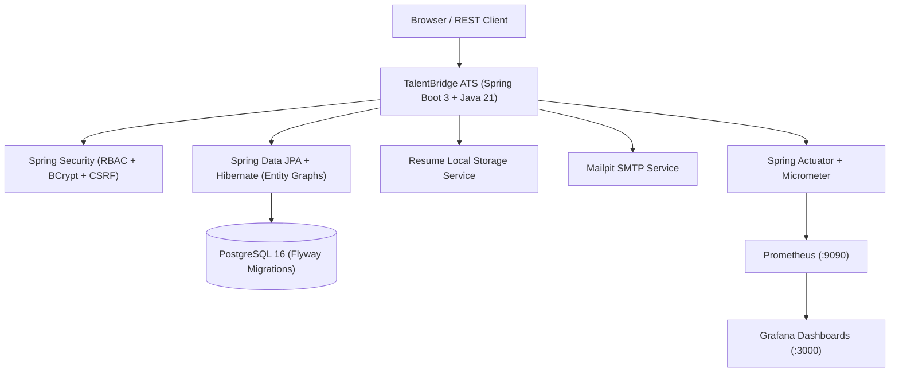

# ⚡ TalentBridge Enterprise ATS + Full DevOps Ecosystem

[](https://github.com/ashokpsgitech/devops-mini-project--Recruitment-portal/actions/workflows/ci.yml)

TalentBridge is an enterprise-grade **Recruitment and Applicant Tracking System (ATS)** engineered with **Spring Boot 3**, **Java 21 LTS**, **PostgreSQL 16**, and a complete DevOps ecosystem featuring **Apache Maven**, **Docker & Docker Compose**, **GitHub Actions CI/CD**, **Prometheus & Grafana observability**, and **Aqua Security Trivy DevSecOps scanning**.

---

## 1. System Architecture & Capabilities



### Key Modules & Workflows
- **Role-Based Access Control (RBAC):** `ADMIN`, `RECRUITER`, `HIRING_MANAGER`, `APPLICANT`.
- **Requisition Management:** Job posting lifecycle (`DRAFT → PUBLISHED → CLOSED`), department mapping, salary ranges, full-text role search.
- **Applicant Portal:** Profile registration, resume upload (PDF/DOCX), cover letters, application status tracking.
- **Candidate Pipeline Kanban:** Visual ATS stage management (`APPLIED → SCREENING → SHORTLISTED → INTERVIEW → OFFERED → HIRED → REJECTED`) with audit trail.
- **Interview Scheduling & Feedback:** Multi-round evaluation (Technical, Behavioral, Executive), scoring (1-5), and recommendation logging.
- **Compensation & Offer Management:** Offer extension, joining date, validity window, candidate acceptance/decline lifecycle.
- **In-App & Email Notifications:** Real-time event notifications with unread badges and SMTP delivery.
- **REST API & OpenAPI 3.0:** Programmatic endpoints documented via Swagger UI.

---

## 2. Technology Stack

| Layer | Technologies |
|---|---|
| **Build & Dependency Management** | Apache Maven 3.9+, Maven Wrapper (`mvnw`, `mvnw.cmd`) |
| **Core Framework** | Java 21 LTS, Spring Boot 3.5.7, Spring Security 6 |
| **Persistence** | Spring Data JPA, Hibernate ORM 6.6, PostgreSQL 16, Flyway 10 |
| **API & Documentation** | SpringDoc OpenAPI 2.8.5, Swagger UI, Spring MVC REST |
| **Frontend UI** | Thymeleaf 3, Plus Jakarta Sans, Modern Glassmorphism CSS, Vanilla JS |
| **Testing** | JUnit 5, Mockito, Spring Boot Test, MockMvc, JaCoCo, H2 (test scope) |
| **Observability** | Spring Actuator, Micrometer Prometheus, Prometheus 2.52, Grafana 11 |
| **Containerization** | Docker multi-stage build (distroless-style JRE, non-root user), Docker Compose |
| **CI/CD & DevSecOps** | GitHub Actions (`.github/workflows/ci.yml`), Aqua Security Trivy |

---

## 3. Quickstart: Local Development

### Option A: Run with Docker Compose (Full Stack)
Spin up the complete application stack including PostgreSQL, Mailpit, Prometheus, and Grafana:

```bash
docker compose up --build -d
```

| Service | URL | Default Credentials |
|---|---|---|
| **TalentBridge Web UI** | `http://localhost:8080/jobs` | *See seed users below* |
| **Swagger UI (REST API)** | `http://localhost:8080/swagger-ui/index.html` | Any valid user |
| **Actuator Metrics** | `http://localhost:8080/actuator/prometheus` | None |
| **Grafana Telemetry** | `http://localhost:3000` | `admin` / `admin` |
| **Prometheus Server** | `http://localhost:9090` | None |
| **Mailpit Webmail** | `http://localhost:8025` | None |

### Option B: Run Locally with Maven & Local PostgreSQL
1. Ensure PostgreSQL is running on port 5432 with database `recruitment_db`.
2. Configure environment variables or `.env`:
   ```powershell
   $env:DB_URL="jdbc:postgresql://localhost:5432/recruitment_db"
   $env:DB_USERNAME="recruitment_app"
   $env:DB_PASSWORD="your_password"
   ```
3. Run with Maven Wrapper:
   ```powershell
   .\mvnw.cmd spring-boot:run
   ```

---

## 4. Default Seed Accounts

The database migrations (`V2__seed_roles_and_admin.sql`) provision seed credentials for immediate local testing:

| Role | Username | Password | Purpose |
|---|---|---|---|
| **Administrator** | `admin` | `Admin@123!` | Complete system access & API docs |
| **Recruiter** | *Register directly or via admin* | - | Job posting, Kanban pipeline, offers |
| **Hiring Manager** | *Register directly or via admin* | - | Interview evaluations & scorecards |
| **Applicant** | *Register via `/register`* | - | Job search, apply, accept/decline offers |

---

## 5. Verification & Test Execution

The project includes unit, service, repository, security, and REST controller tests:

```powershell
# Run all tests and generate JaCoCo coverage reports
.\mvnw.cmd clean test

# Package production executable JAR (skipping tests)
.\mvnw.cmd package -DskipTests
```

---

## 6. Automated CI/CD & DevSecOps Pipeline

The automated GitHub Actions workflow (`.github/workflows/ci.yml`) runs on every push and pull request:
- **Build & Verification**: JDK 21 build with Maven Wrapper (`./mvnw clean verify -B`).
- **Unit & Integration Testing**: 20 automated tests validating business rules, authorization, and repositories.
- **Code Coverage**: JaCoCo reports archived for analysis.
- **DevSecOps Security Scanning**: Aqua Security Trivy scans the Docker image for OS/package CVE vulnerabilities.
- **Docker Verification**: Verifies container layers, startup behavior, and actuator health probe.
